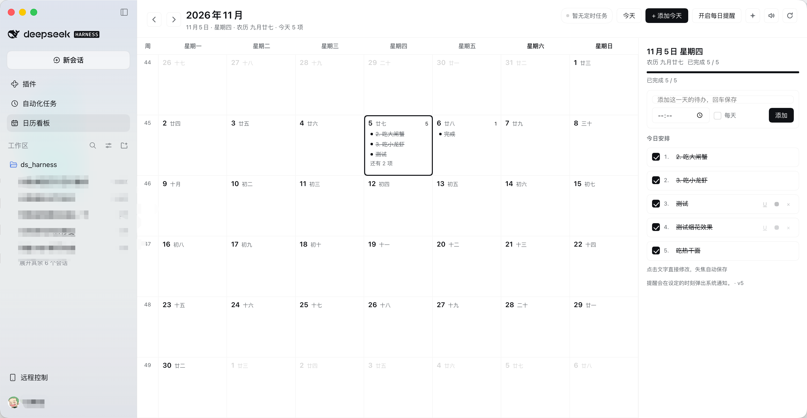

# Calendar Board for DeepSeek Harness

**English** · [中文](README.zh.md)

A month-view calendar board for [DeepSeek Harness](https://deepseek.com) desktop: your daily notes, the reminders you scheduled inside DSH, inline editing right in the grid — and a little celebration every time you finish something.



> Pure front-end plugin. No build step, no third-party dependencies, no network calls. Your entries live in the page's localStorage; scheduled reminders are read-only.

## Features

**Month view**
- Whole-month grid starting on Monday, with ISO week numbers, lunar dates (via `Intl`'s Chinese calendar), a highlighted today, and trailing days from the adjacent months
- Each cell shows the first 3 entries plus a remaining count; colors, underlines and strikethroughs are preserved

**Inline editing**
- Click any day cell to edit it in place: an input appears inside the cell, Enter adds another entry and keeps the caret there
- Every line is directly editable and **saves as you type**; Esc or clicking elsewhere exits, and an uncommitted draft is still persisted
- Clear a line and leave it to delete the entry

**Per-entry controls**
- Check an entry to complete it — it gets a strikethrough and dims; uncheck to revert
- Hover the end of a row: `U` toggles underline, `●` cycles the text color (default / red / amber / green / blue), `×` deletes
- The day panel numbers entries `1. 2. 3.` and shows a completion progress bar

**Scheduled reminders**
- Reads DSH's `schedule` service and expands daily / weekly / one-shot / every / cron reminders into the calendar
- A header badge shows the sync state; the Host half also exposes a read-only `/calendar-board/schedules` route as a fallback source

**Completion celebration**
- Finishing an entry plays a three-note arpeggio (synthesized with WebAudio), draws canvas fireworks, adds CSS confetti and shows a toast
- `✦` in the header previews the effect at any time; the speaker toggles sound (remembered locally)
- Respects the system "reduce motion" preference

**Extras**
- Daily nudges through system notifications, fired at the time you set
- Chinese and English UI, built entirely on DSH theme tokens so light and dark both work

## Install

### One-liner (recommended)

Open a new session in DSH and tell your agent:

```
Install the plugin github:jy007/dsh-calendar-board
```

The agent calls the plugin manager's `install_bundle`. A calendar icon appears in the sidebar afterwards; if it does not, reload the window or restart DSH.

### Manual

```bash
git clone https://github.com/jy007/dsh-calendar-board.git ~/plugins/dsh-calendar-board
```

Then ask your DSH agent to install `~/plugins/dsh-calendar-board` as a bundle, or pick that directory in the plugin manager.

### Update

```bash
cd dsh-calendar-board && git pull
```

Then install `github:jy007/dsh-calendar-board` again in DSH. The plugin installs a **snapshot copy**, so it does not follow the repository by itself; the `vX.Y.Z` in the panel footer is the version currently running.

### Uninstall

Remove `dsh-calendar-board` in the plugin manager. Your entries stay in the browser's local storage.

## Usage

1. Click the **calendar icon** in the sidebar to open the board
2. Click a day and start typing right in the cell (Enter keeps going, Esc exits)
3. Check an entry to complete it → chime + fireworks; hover for color, underline, delete
4. Header: `‹ ›` month, `Today`, `+ Add for today`, `Daily nudge`, `✦` preview the fireworks, speaker to mute, `⟳` resync scheduled reminders

## Data and privacy

| What | Where |
| --- | --- |
| Your entries | browser localStorage: `dsh-calendar-board.items.v1` |
| Sound preference | `dsh-calendar-board.sound.v1` |
| Daily nudge preference | `dsh-calendar-board.notify.v1` |
| Scheduled reminders | read-only, from the DSH `schedule` service, never stored |

No network requests beyond DSH's own local HTTP port.

## Compatibility

- DSH Desktop NEXT (the `desktop-next` profile, Web GUI)
- Registers the Client slots `sidebar.panellist` (icon) and `main` (panel)
- Optional Host services: `schedule` (without it the header shows "Scheduled reminders unavailable" and everything else still works) and `webServer` (without it only the remote channel is used)

## Development

```
dsh-calendar-board/
├── package.json        # dsh.bundle / dsh.client manifest
├── cordis.patch.yml    # inserts the calendar-board row
├── index.js            # Host half: read-only schedules route
├── client.js           # Client half: panel + sidebar icon (classic script, IIFE)
├── locale/{zh,en}.json # title and description shown by the plugin manager
└── icon.svg
```

`client.js` is loaded by the page as a **classic script**, and HMR evaluates the same file more than once, so every declaration is wrapped in an IIFE — otherwise the second evaluation throws `Identifier '...' has already been declared`.

To develop against a checkout, link the directory into your profile:

```
Install the plugin /absolute/path/to/dsh-calendar-board
```

Edits to `client.js` hot-reload; edits to `index.js` (the Host half) need a DSH restart.

## Changelog

- **1.0.1** — README screenshot; the panel footer now shows the package version
- **1.0.0** — first public release: month view, inline editing, complete / underline / color / delete per entry, scheduled-reminder overlay, completion chime + fireworks + confetti

## License

MIT © 2026 jy007
