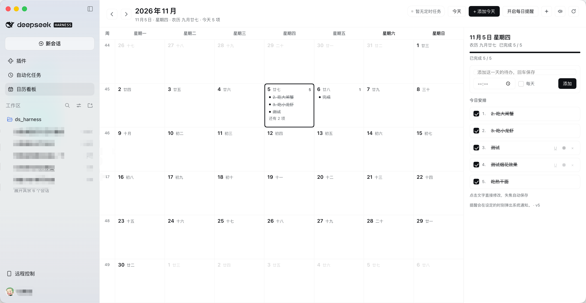

# 日历看板 · Calendar Board for DSH

[English](README.md) · **中文**

给 [DeepSeek Harness](https://deepseek.com) 桌面端加一块**月视图日历看板**：每天要做的事、DSH 里设置的定时任务、点击日期格直接编辑，勾掉一条就放烟花。



> 纯前端插件，无构建步骤、无第三方依赖、不上传任何数据。事项存在本机页面的 localStorage 里，定时任务只读。

## 功能

**月视图**
- 周一起始的整月网格，带 ISO 周号、农历（`Intl` 中国历）、今天高亮、跨月补格
- 每格显示当天前 3 条事项与剩余条数，颜色/下划线/删除线原样呈现

**直接编辑**
- 点任意日期格即进入编辑：格子内出现输入框，回车新增一条并保持焦点
- 每条文字可直接点改，**改完即时保存**；Esc 或点到别处退出编辑，未提交的草稿也会自动落盘
- 清空一条文字后离开即删除

**每条事项**
- 勾选完成 → 文字加删除线变灰；再点取消
- 悬停行尾：`U` 下划线开关、`●` 循环换色（默认/红/橙/绿/蓝）、`×` 删除
- 右侧当日面板按 `1. 2. 3.` 编号，带完成进度条

**定时任务叠加**
- 读取 DSH 的 `schedule` 服务，把 daily / weekly / 一次性 / every / cron 提醒按天展开进日历
- 顶栏徽标显示同步状态；Host 侧另有只读路由 `/calendar-board/schedules` 作为备用数据源

**完成庆祝**
- 完成一条：三音琶音（WebAudio 实时合成）+ canvas 烟花 + 纯 CSS 彩带 + 顶部气泡
- 顶栏 `✦` 可随时预览效果，喇叭可一键静音（状态本地保存）
- 尊重系统「减少动态效果」

**其他**
- 每日提醒（系统通知，按设定时间触发）
- 中英文界面，全部使用 DSH 主题 token，深浅色自动适配

## 安装

### 一键安装（推荐）

在 DSH 里开一个新会话，对助手说一句：

```
安装插件 github:jy007/dsh-calendar-board
```

助手会调用插件管理器的 `install_bundle` 完成安装。装完侧栏出现日历图标；如果没出现，重载窗口或重启 DSH。

### 手动安装

```bash
git clone https://github.com/jy007/dsh-calendar-board.git ~/plugins/dsh-calendar-board
```

然后在 DSH 里让助手把 `~/plugins/dsh-calendar-board` 安装为 bundle，或在插件管理器里选择该本地目录。

### 更新

```bash
cd dsh-calendar-board && git pull
```

然后在 DSH 里重新安装一次 `github:jy007/dsh-calendar-board`。插件安装的是**快照副本**，不会自动跟随仓库变化；面板右下角的 `vX.Y.Z` 就是当前运行版本。

### 卸载

在插件管理器里移除 `dsh-calendar-board` 即可；事项数据随浏览器本地存储保留。

## 使用

1. 点侧栏的**日历图标**打开面板
2. 点某一天，直接在格子里写今天要做的事（回车继续写，Esc 退出）
3. 勾选事项 → 音效 + 烟花；悬停可换色、加下划线、删除
4. 顶栏：`‹ ›` 换月、`今天` 回到本月、`+ 添加今天`、`每日提醒`、`✦` 预览烟花、喇叭静音、`⟳` 重新同步定时任务

## 让 Agent 直接读写看板

Host 半是唯一的数据源，所以**任何 DSH 会话**都能通过一个工具读改看板，不需要截图、不需要猜：

```jsonc
{ "action": "list", "from": "2026-11-02", "to": "2026-11-08" }
{ "action": "add", "date": "2026-11-06", "title": "给 adon 发邮件", "time": "10:00" }
{ "action": "complete", "id": "itmw3c6bd3c83xd" }
{ "action": "remove", "id": "itmw3c6bd3c83xd" }
```

| action | 参数 | 说明 |
| --- | --- | --- |
| `list` | `date` 或 `from`/`to`、`includeDone` | 返回 `id`、`date`、`time`、`title`、`done`、`repeat`、`color` |
| `add` | `title`，可选 `date`（默认今天）、`time`、`repeat:"daily"` | 新增一条 |
| `update` | `id` + `title`/`date`/`time`/`repeat`/`color`/`underline` 任意项 | 原地修改 |
| `complete` | `id`，可选 `date`、`done` | 勾选/取消某一条的某一天 |
| `remove` | `id` | 删除 |

可以直接对助手说：

- 今天还剩哪些事没做？
- 帮我加一条：明天 10 点给 adon 发邮件
- 把「吃小龙虾」标记完成

其他插件也可以直接调用同一个实现（Host 服务 `calendarBoard`）。

## 数据与隐私

| 内容 | 位置 |
| --- | --- |
| 你写的事项 | Host 侧 `<DSH_HOME>/storages/calendar-board/items.json`；页面保留一份 localStorage 缓存 |
| 音效开关 | `dsh-calendar-board.sound.v1` |
| 每日提醒开关 | `dsh-calendar-board.notify.v1` |
| 定时任务 | 只读，来自 DSH `schedule` 服务，不落盘 |

除本机 DSH 自己的 HTTP 端口外，没有任何网络请求。面板底部会显示 `已同步 Host` / `仅本机保存`，一眼能看出它有没有接上 Host 存储。

## 兼容性

- DSH Desktop NEXT（`desktop-next` profile，Web GUI）
- 使用 Client slots：`sidebar.panellist`（图标）、`main`（面板）
- 可选依赖 Host 服务 `schedule`（缺失时顶栏显示「定时任务不可用」，其余功能正常）与 `webServer`（缺失时只用 remote 通道）

## 开发

```
dsh-calendar-board/
├── package.json        # dsh.bundle / dsh.client 清单
├── cordis.patch.yml    # 插入 calendar-board 这一行
├── index.js            # Host 半：只读 schedules 路由
├── client.js           # Client 半：面板 + 侧栏图标（classic script，IIFE 包裹）
├── locale/{zh,en}.json # 插件管理器里的标题与描述
└── icon.svg
```

注意：`client.js` 由页面以**经典脚本**加载，HMR 会重复求值同一份文件，因此所有声明都包在 IIFE 里 —— 否则第二次求值会抛 `Identifier '...' has already been declared`。

本地开发时把目录链接进 profile 即可：

```
安装插件 /绝对路径/dsh-calendar-board
```

改 `client.js` 后 HMR 会热加载；改 `index.js`（Host 半）需要重启 DSH。

## 更新日志

- **1.1.0** — Host 侧存储 + `calendar_board` Agent 工具 + `calendarBoard` 服务；面板改为同步 Host 存储，不再只存在 localStorage
- **1.0.1** — README 截图；面板版本号改为跟随包版本
- **1.0.0** — 首个公开版本：月视图、内联编辑、完成/下划线/换色/删除、定时任务叠加、完成音效 + 烟花 + 彩带

## License

MIT © 2026 jy007
